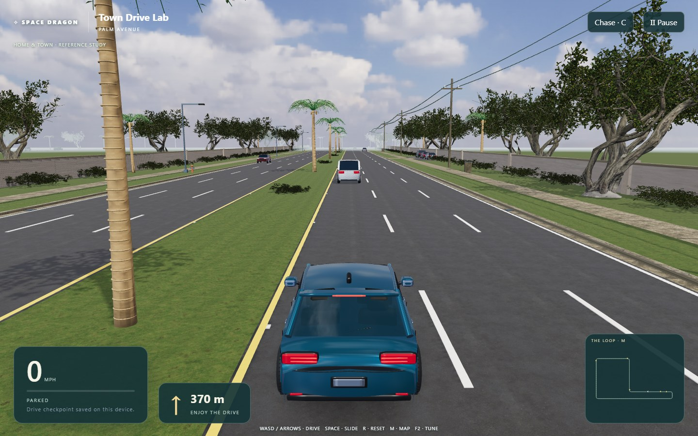

# Town Drive detail and rule-removal verification — October 30, 2026

## Scope and authority

- **SD-052:** the owner rejected the primitive appearance, requested detail close to photorealistic, explicitly overrode the privacy rule and said “remove the rule”. [Decision](../decisions/2026-10-30-town-drive-detail-override.md).
- **SD-055:** follow-up explicitly adds NPC cars, traffic and agent-chosen details. [Decision](../decisions/2026-10-30-town-drive-traffic.md). Implementation includes 64 bidirectional vehicles, three original body variants/eight paint colors, 12 parked cars, signals/queues/brake lights, bus shelters, street lighting, hydrants, utility cabinets and parking bays. NPC time freezes on pause.
- **Base:** `1495dedfa3a9ddb33f1d51b8ad6166400ba68a17`, branch `feat/town-drive-lab`, draft [PR #23](https://github.com/paulmalmquist/space_dragon/pull/23). Parallel uncommitted Dogfight/Blender work is excluded from the Town Drive review projection.
- **Rule removal:** active project instructions and Town Drive documents no longer require an additional real-layout approval or a fictional-only production build. `reference-house.json` is bundled in development and production. The dev-only layout middleware is removed. Original source words and old receipts remain historical evidence with explicit supersession notices.
- **Visual implementation:** photographed PBR road/grass/concrete/plaster/wood/fabric materials; photographed HDR sky and environment reflections; detailed textured vegetation with instancing and LOD; modeled car and furnishings; directional shadows, curb faces, gutters, drains, pavement joints, reflectors, utility details and neighborhood architecture. The camera is lower and closer.
- **Unchanged simulation:** fixed-step handling, ordered checkpoints, route, assist, input release, recovery and separate drive save. Distances/layout remain estimated and connectors invented. This is not a measured reconstruction or a full model of both house levels.

## Asset provenance

Photographed materials/sky and the coastal tree and its derived hedge come from Poly Haven under CC0. The palm is an original Innerscene CC0 library model. Source URLs, author credits, original hashes, transformations and runtime hashes are stored with the assets in `public/assets/drive/materials/PROVENANCE.json` (materials and sky) and `public/assets/drive/vegetation/PROVENANCE.json` and the global runtime manifest. Car, house furnishings and road geometry are original code. All runtime assets load from the same origin; no runtime external service is required. Downloads did not transmit the owner's videos. No purchase, hosting change or production deployment occurred.

The final sky is a prefiltered Babylon `.env` container, generated once from the photographed 2K HDR source. This retains the 512-pixel cubemap and polynomial irradiance while removing repeated 4,096-sample runtime filtering. Native before/after image comparison differed by only 0.038–0.049 mean RGB levels out of 255; a single fresh-context readiness diagnostic improved from 9.48 to 3.87 seconds under concurrent load. These are diagnostics, not a stable loading benchmark. The original HDR remains in local source storage.

The initial whole-mesh tree reduction was rejected during actual screenshot review because it removed too much foliage. The revised asset processing preserves leaf placement with photographed leaf cards. Final vegetation v005 contains 28,000/13,848 palm, 44,826/12,775 canopy and 9,928/3,310 hedge triangles at near/far LOD. The three GLBs total 9,565,472 bytes; all 27 runtime asset/provenance files total 18,790,367 bytes. Runtime hashes are checked against the manifest. Changed GLBs passed `gltf-transform validate` with exit 0 and no hints; the unchanged palm had already passed.

## Appearance and measured performance

The image shows the actual running scene with NPCs, the modeled player car, photographed surfaces, sky, trees and roadside details. It is a substantial realism upgrade; the procedural buildings, repeated vegetation, compressed route and estimated house remain approximations. Owner acceptance of “close to photorealistic” is not inferred from this screenshot.

Final fresh-context installed Chrome 156.0.8078.76, headless, ANGLE Direct3D11 on the Lenovo 82XM's AMD Radeon integrated GPU (Ryzen 7 5825U), rendered at 1440 × 900, device scale 1. After three seconds of keyboard acceleration, a 20.002-second active chase drive produced 1,201 frames: **60.04 fps**, median **16.7 ms**, p95 **17.1 ms**, maximum **17.4 ms**, zero frames above 33.4 ms, and no page/console errors. This was actual rendering on the named GPU, not SwiftShader. The sample covered Palm Avenue from roughly route distance 236 m to 716 m; it is not whole-route, thermal or endurance evidence.

An earlier detailed candidate measured only 8.82 fps. Profiling found rendering/shadows, rather than the 64-car simulation, dominated cost. Final changes use 1024-pixel low-quality PCF shadows with bounded casters, a 55 m plant shadow radius, lighter leaf cards, native instances/LOD, prefiltered environment lighting, and 10 Hz rendering while paused (active driving remains every animation frame). Matched canopy screenshots retained full crowns. The failed candidate's data is retained locally beside the final sample.

Reproduction/evidence: local `artifacts/drive-detail-benchmark.mjs`, `artifacts/drive-detail/hardware-traffic-benchmark.json`, `artifacts/drive-detail/traffic-final.png`; vegetation A/B and validator logs under `assets/reference/local/environments/drive-review/vegetation-performance-v005/`. No performance claim is made for a physical controller, touch device or sustained full loop.

## Checks

| Check | Result | Evidence and limit |
| --- | --- | --- |
| Root TypeScript | PASS | Typecheck after world/material/car/house integration. |
| Isolated review unit tests and build | PASS | Final code/assets projected onto clean branch head: 58 units, TypeScript and Vite build pass. Full wrapper browser/production stages are recorded below. |
| Installed Chrome actual keyboard | PASS | Three seconds holding W moved from spawn to x = −17.65 m; speed 12.57 m/s; no collision/reset. |
| Screenshot review | PASS, agent visual inspection | Final image above plus local car/house/vegetation views. Initial foliage defects were found and corrected. Human visual acceptance remains separate. |
| SwiftShader first drive smoke | Initial FAIL; corrected smoke PASS | Initial five-second motion poll expired during shader preparation. The start button now waits for scene readiness. A subsequent keyboard smoke passed; final complete suite follows the prefiltered environment change. |
| `npm.cmd run check` in isolated review | PASS, exit 0 | Complete wrapper: 10 m 33.1 s. 58 unit tests, TypeScript/Vite build, all 28 development browser cases (9.7 m), all six production cases (45.9 s), and all 18 photo inventory checks. Includes First Contact/navigation regressions, simulated proportional controller, pause/focus/reset, storage failures, traffic signals/collisions, complete route/reload and built asset inspection. Final log: clean-review `artifacts/detail-check.log`. |
| Runtime manifest / production byte parity | PASS | All 27 files in `public` and `dist` exactly match the manifest's size/SHA-256; no extras or missing assets. Local `artifacts/drive-final-asset-hashes.json` and `artifacts/drive-final-verification.json` retain the inventory. |
| `python tools/check_foundation.py` | PASS | Foundation structure and skill mirrors. Documentation-only verification; not gameplay or agent behavior. |
| `python -m unittest discover -s tests -p test_*.py -v` | PASS | 41 cases, two host-specific skips. |
| Complete streamed loop with traffic and reload | PASS | The conservative automated controller completed all ordered gates and returned home in 456.13 simulated seconds (7 m 36 s), with 90 actual rendered frames and 7–15 loaded chunks. Traffic collision and signal simulation still ran every fixed tick. Local evidence: clean-review `artifacts/drive-loop-final.json`. |
| Original 3–5 minute cruising target with traffic | NOT VERIFIED | The scripted driver follows slower cars and waits for lights; its measured lap is longer. The earlier 239-second unobstructed lap is historical. Human driving/overtaking time has not been measured. |
| Fresh native-GPU 20-second active drive | PASS | 60.04 fps at 1440 × 900; exact environment/scenario above. |
| Sustained hardware/physical controller/human appearance acceptance | NOT TESTED | No automated run implies owner approval of photorealism, final art or sustained performance. |

## Review and release

IMPLEMENTED and technically VERIFIED for the checks above; agent code/package and screenshot review completed. The requested Town Drive reference-layout publication permission is granted by the owner's override. Final human appearance/fun review, physical controller, audible chime quality and sustained hardware performance remain open. No production deployment or final art approval is claimed. The native 60.04 fps sample above measures this final detailed scene.

The earlier full wrapper run, before prefiltered lighting and final leaf/shadow optimization, passed 26/28 development cases but exceeded budgets in checkpoint reload and the whole-loop test. Its log/traces remain under clean-review `artifacts/detail-check-before-prefilter.log` and `artifacts/test-results-before-prefilter/`. The final complete run passes both. Browser tests use 960 × 640 SwiftShader; the full route advances normal fixed-step inputs and renders every 60 m or five simulated seconds, inside the 310 m loaded collision corridor. This tests streaming and completion without claiming real-time software-rendered performance.

The reviewed source is the Town Drive-only projection onto base `1495ded`, with exact runtime file hashes in `public/assets/manifest.json`. The draft PR remains stacked on `feat/first-contact-playable`. Remote CI is checked after push and reported separately; no local pass is represented as a remote pass.

Rollback is a scoped revert of this detail increment. Original source videos and the earlier working driving prototype remain available. Do not revert unrelated parallel work.
