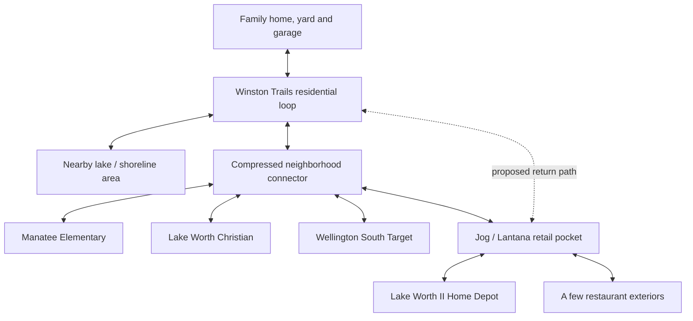

# A small neighborhood of familiar places

**Recorded:** October 29, 2026 · **Idea:** SD-024  
**Authority:** CONFIRMED places and compact-world direction; PROPOSED game layout and restaurant choices.  
**Work state:** planned. The existing room/yard navigation is a verified foundation; this neighborhood has not been built or playtested.

The owner wants a small playable neighborhood that brings together Winston Trails and familiar Lake Worth-area destinations. Use recognizable names, public-facing landmarks and Florida character, with distances compressed into a world that feels good to explore. Preserve the [game-feel bar](../engineering/GAME_FEEL.md) as the space grows.

## Confirmed anchors

| Place | Public reference and owner choice | Intended map role |
| --- | --- | --- |
| Family home, yard and garage | Existing story opening; owner supplied a home anchor kept in ignored local reference notes (SD-026). Later [owner video](../REFERENCE_HOME_VIDEO.md) will inform the space; footage remains pending. | Starting point and familiar return destination, compressed placement in the game. |
| Surrounding residential streets and nearby lake | Owner explicitly requested these with the home anchor (SD-026). [The reference log](REFERENCE_LOG.md) distinguishes collected data from pending imagery; no lake name is assumed. | Familiar residential setting and a readable lake/shoreline landmark. |
| Winston Trails | The [official HOA site](https://winstontrailshoa.com/) identifies the community and lists its public contact address as 5980 Winston Trails Blvd., Lake Worth. This is not an inferred owner-home address. | Residential character and neighborhood loop. |
| Target — Wellington South | Owner selected “wellington target.” The [official store page](https://www.target.com/sl/wellington-south-store/2065) identifies 5900 State Rd 7, Lake Worth. | Recognizable retail destination. |
| The Home Depot — Lake Worth II | Owner selected “home depot on lantana and jog.” The [official store page](https://www.homedepot.com/l/Lake-Worth-II/FL/Lake-Worth/33467/6316) identifies 5750 Jog Rd, Lake Worth. | Retail destination in the Jog/Lantana pocket. |
| Lake Worth Christian School | The [official school page](https://www.lwcs.org/apps/pages/index.jsp?type=d&uREC_ID=577185) lists 7592 High Ridge Road, Boynton Beach. | Distinct school landmark. |
| Manatee Elementary School | The [official school-information page](https://mnes.palmbeachschools.org/school-information) lists 7001 Charleston Shores Blvd., Lake Worth. | Distinct school landmark. |

These addresses identify references. They do not establish game coordinates, exact travel routes, private interiors or a component/mission assignment.

## Proposed connections

**PROPOSED GAME TOPOLOGY ONLY.** This diagram shows playable connections, not geographic position, compass directions, real roads, school routes or driving directions. The destinations occupy a compressed neighborhood even where their real locations are farther apart.

Use clear sightlines, recognizable silhouettes and a small number of readable junctions. Connect the home to the destinations through roads, sidewalks and landscaped spaces that support comfortable third-person movement. Exact road shapes, crossings and the return path can change during the blockout review.

## Restaurant pocket

Adding a few nearby restaurants is **CONFIRMED owner direction**. This initial roster is an **agent proposal**, not a claim that the owner selected these particular restaurants. Begin with recognizable exteriors as scenery; ordering, menus, NPCs and restaurant missions are not part of this plan.

| Candidate | Verified public reference |
| --- | --- |
| Chili's — Lantana | The [official location page](https://www.chilis.com/locations/us/florida/greenacres/lantana) lists 5910 Jog Rd., Greenacres. |
| Chipotle | The [official location page](https://locations.chipotle.com/fl/lake-worth/6177-s-jog-rd) lists 6177 S Jog Rd, Lake Worth, near Lantana and Jog. |
| Chick-fil-A — Lake Worth South | The [official Florida directory](https://www.chick-fil-a.com/locations/browse/fl) lists 6275 Lantana Rd, Greenacres. |

## Reference use

The owner permits logging images from Google Maps to inform this environment. [The reference log](REFERENCE_LOG.md) owns source links, capture status and observations. Maps image capture is currently pending; this document does not claim screenshots have been collected.

Keep captured references in ignored local reference storage and record what each image helps establish: facade shape, landscaping, roofline, sidewalk or the feel of an approach. Build game geometry and materials through [the asset pipeline](../ASSET_PIPELINE.md); reference screenshots are not runtime textures. Public names and visible landmarks can stay recognizable while school/workplace interiors and sensitive layouts remain fictionalized. The fictional neighbor and existing family-reference boundaries are unchanged.

## Open choices and the next blockout

Exact dimensions, road lengths, walking times, traversal speeds, sight distances and performance budgets are **OPEN**. Select numeric targets from a first playable blockout and review on the Lenovo/Chrome target. Real-world mileage is reference context, not the game scale.

The next useful coding increment is a connected road/sidewalk blockout with the residential/lake area, labeled landmark masses and the proposed restaurant pocket. Reuse the current player, camera, collision and local-save boundaries. Walk out from home, reach each landmark and return; adjust junctions and sightlines before detailed buildings or missions. If world geometry changes, validate saved positions and retain earned inventory when recovering to a safe position.

When implemented, record the actual connected routes, collision/camera behavior, loading and real-device observations. A diagram, building label or compilation does not verify a walkable neighborhood. The [decision](../decisions/2026-10-29-neighborhood-map.md) records authority and the scope change; [status](../project/STATUS.md) remains the source for implementation evidence.
